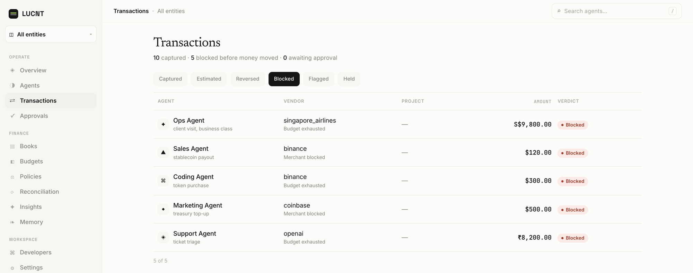
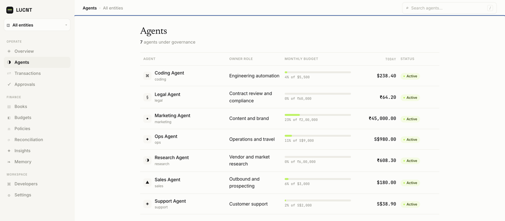
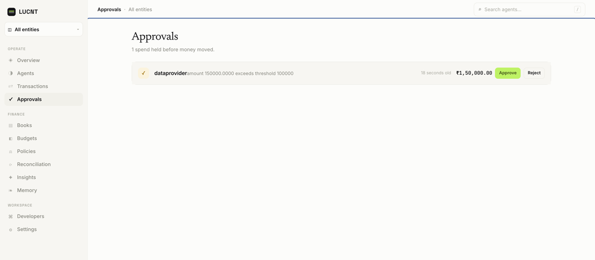
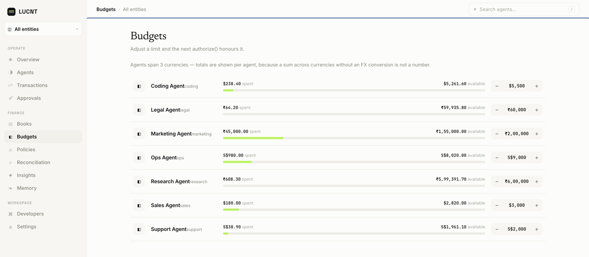

# LUCNT

**A spend gate and a ledger for the AI agents you already run.**

[](https://github.com/anushtup-nandy/lucnt/actions/workflows/ci.yml)
[](LICENSE)
[](https://www.python.org/)



LUCNT gives agent spend a **gate** and a **ledger**.

- **The gate runs before money moves.** The policy engine can stop a spend. It does not only log it.
- **The ledger books each spend.** Each captured spend gets a double-entry journal and a tax treatment.
- **One primitive covers all spend.** A flight, a SaaS seat and a batch of LLM tokens use the same two calls.
- **There is no `Agent` class.** Agent identity is a string. LUCNT works with any agent framework.

LUCNT is self-hosted. It is not on PyPI. Install it from source.

---

## How it works

```text
authorize()  ──▶  policy engine  ──▶  approved | blocked | review | human_hold
                                        │
                          your purchase happens here
                                        │
capture()    ──▶  commit transaction, then:
                    ├─ tax engine         IN GST reverse charge, US sales/use, SG
                    ├─ journal generator  double-entry against a chart of accounts
                    ├─ invoice hook       attach, or queue for matching
                    └─ events             agent.spend.created, budget.exhausted
```

1. Your agent calls `authorize()` before it spends.
2. The policy engine examines budgets, merchant lists, velocity, amount limits and hours.
3. The engine returns a verdict. A `blocked` or `human_hold` verdict stops the spend.
4. Your agent makes the purchase on its own payment rail.
5. Your agent calls `capture()`. LUCNT writes the transaction, the journal and the tax record.

All spend sources use the same capture path: SDK, card rail and invoice.

---

## Dashboard

The dashboard is the control surface for people. Use it to set policies and budgets, approve held spends and read the books.

| Agents | Approvals | Budgets |
|---|---|---|
|  |  |  |

Each persona sees a different scope: engineer, CFO, agent owner, approver and auditor. The server applies the scope, not the UI.

---

## Quickstart

**Prerequisites:** Python 3.12 and Docker. Node 22 is necessary only for the dashboard.

```bash
git clone https://github.com/anushtup-nandy/lucnt.git
cd lucnt

# 1. Start Postgres, Redis and Mailpit
docker compose -f infra/docker-compose.yml up -d

# 2. Start the backend
cd backend
python -m venv .venv && source .venv/bin/activate
pip install -e ".[dev]"
cp .env.example .env              # the defaults match infra/docker-compose.yml
alembic upgrade head
python scripts/seed_dev.py        # prints a dev API key and dashboard logins
uvicorn lucnt_api.main:app --reload --port 8000

# 3. Install the SDK (new terminal, from the repo root)
pip install -e ./sdk
export LUCNT_API_KEY=<key printed by seed_dev.py>
```

To start the dashboard, run this command. Then open `http://localhost:5173` and use a login from `seed_dev.py`.

```bash
cd frontend && npm ci && npm run dev
```

The SDK connects to `http://localhost:8000` by default. To install the SDK in a different project without a clone, run:

```bash
pip install "git+https://github.com/anushtup-nandy/lucnt.git#subdirectory=sdk"
```

---

## Usage

```python
import lucnt

lucnt.configure()  # reads LUCNT_API_KEY and LUCNT_BASE_URL

with lucnt.task(agent="travel-bot", entity="acme-in", intent="team offsite"):
    verdict = lucnt.authorize(
        vendor="United Airlines", amount="842.50", currency="USD", reason="SFO->EWR"
    )
    if verdict.approved:
        book_the_flight()              # your code, your payment rail
        tx = lucnt.capture(verdict)    # tx has the journal and the tax record
    else:
        print("blocked:", verdict.reason)
```

| Call | Purpose |
|---|---|
| `spend()` | Does `authorize` and `capture` in one call |
| `meter(client)` | Meters an OpenAI or Anthropic client automatically |
| `check_budget()` / `query()` | Lets an agent read its own budget and spend history |
| `*_async` | Async version of each call |

For the full SDK guide, see [`sdk/README.md`](sdk/README.md).

---

## Configuration

| Where | Variable | Notes |
|---|---|---|
| SDK | `LUCNT_API_KEY` | Required |
| SDK | `LUCNT_BASE_URL` | Default `http://localhost:8000`. A host that is not local must use `https://` |
| Backend | `ENVIRONMENT` | `development` / `staging` / `production`. No default |
| Backend | `DATABASE_URL` | Postgres DSN |
| Backend | `SECRET_KEY` | 32 characters minimum outside `development` |

[`backend/.env.example`](backend/.env.example) gives all other settings.

**Production notes**

- Keep `(DB_POOL_SIZE + DB_MAX_OVERFLOW) × workers` less than Postgres `max_connections`.
- Behind Nginx, set `set_real_ip_from` and `real_ip_header`. If you do not, all clients share one rate-limit bucket.
- If Redis is not available, rate limiting fails open. `authorize()` continues to operate.

---

## Repository layout

| Path | Contents | Stack |
|---|---|---|
| `sdk/` | `lucnt` Python SDK | Python 3.10+, httpx, Pydantic v2 |
| `backend/` | `lucnt_api` service: policy, books, budgets, reconciliation | FastAPI, SQLAlchemy 2.0, Alembic, Postgres 16, Redis 7 |
| `frontend/` | Dashboard | React 19, TypeScript, Vite, Tailwind, TanStack Query |
| `infra/` | Docker Compose, Nginx, Prometheus alerts | |
| `contracts/` | OpenAPI schema and verdict codes that the SDK and the frontend share | |

---

## Development

```bash
# Backend
cd backend && ruff check src/ tests/ scripts/ && mypy src/ scripts/ && pytest && alembic check

# SDK (fully mocked, no backend necessary)
cd sdk && pip install -e ".[dev]" && ruff check . && mypy src/ && pytest

# Dashboard
cd frontend && npm ci
npm run lint && npm run typecheck && npm run test && npm run build
```

CI ([`ci.yml`](.github/workflows/ci.yml)) also does these checks:

- An Alembic upgrade and downgrade round trip
- An API contract diff
- A gitleaks scan of the full history
- `pip-audit` against the hashed `backend/requirements.lock`
- A check that the container image runs as non-root

---

## Contributing

Issues and pull requests are welcome. See [`CONTRIBUTING.md`](CONTRIBUTING.md). To report a vulnerability, follow [`SECURITY.md`](SECURITY.md). Do not open a public issue.

## License

[Apache-2.0](LICENSE)
